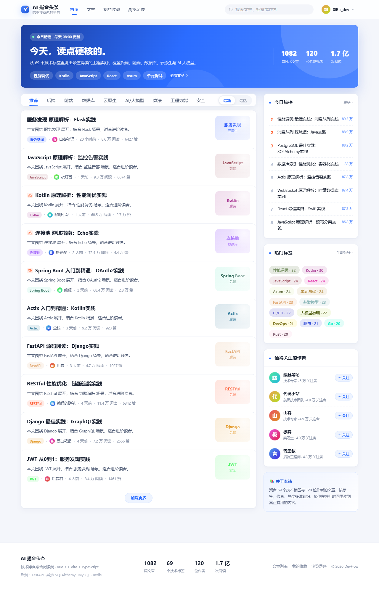
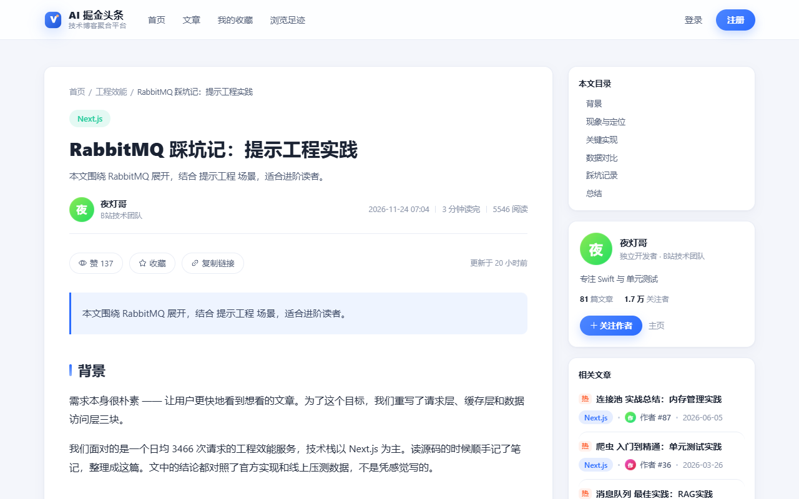
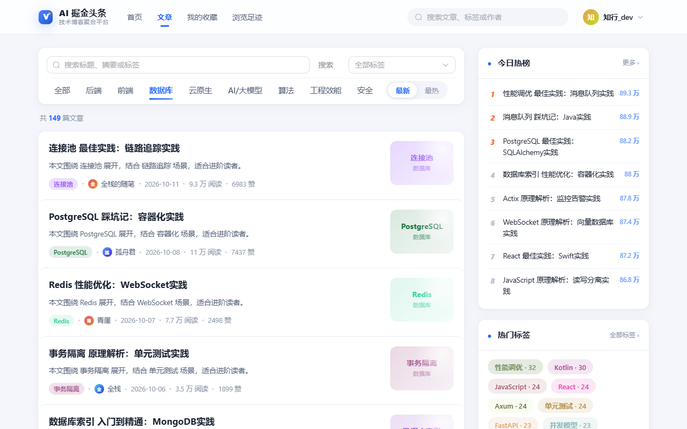
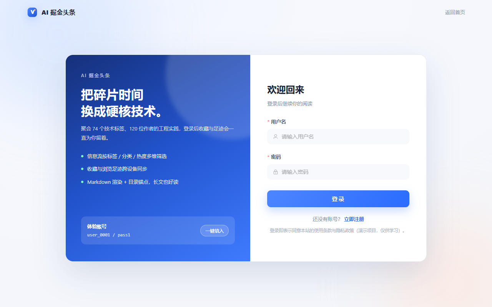
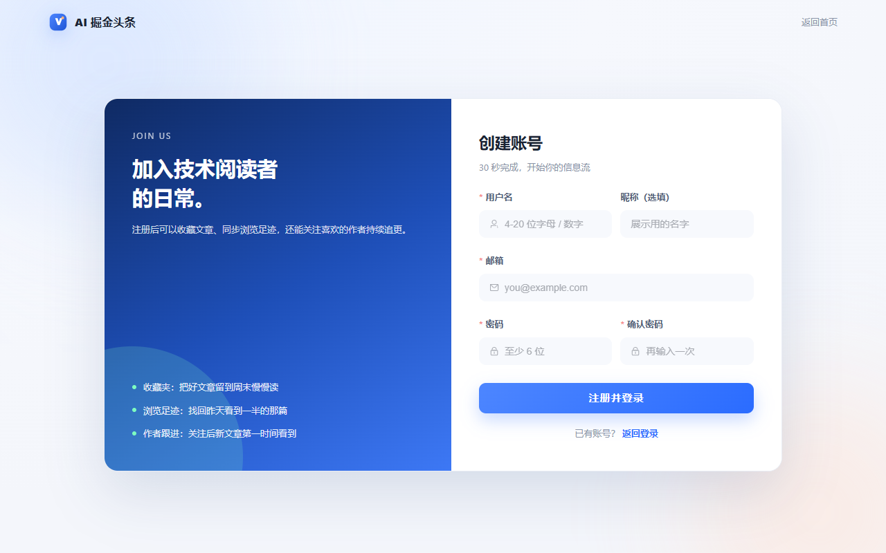
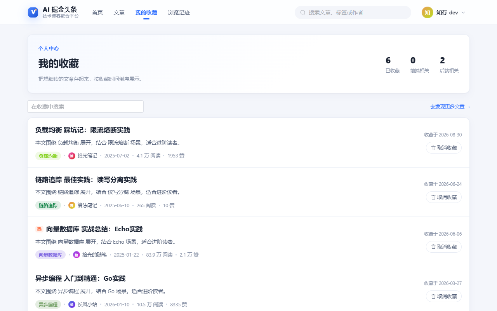

# AI 掘金头条 · 技术博客聚合平台（前端）

按《技术博客前端Vue设计方案》落地的 **纯前端** 工程：Vue 3 + Vite + TypeScript + Vue Router + Pinia + Axios + Element Plus（SCSS 写样式）。
后端由你来实现（FastAPI），前端已经把所有请求收敛在 `src/api/*` 与 `src/utils/request.ts` 两个地方，**替换后端不需要改任何业务代码**。

## 界面预览

| 首页信息流 | 文章详情 |
| --- | --- |
|  |  |

| 文章列表 | 登录 |
| --- | --- |
|  |  |

| 注册 | 我的收藏 |
| --- | --- |
|  |  |

## 快速开始

```bash
pnpm install        # 或 npm install
pnpm dev            # 开发服务器 http://127.0.0.1:5173
pnpm build          # 类型检查 + 生产构建
pnpm preview        # 预览构建产物 http://127.0.0.1:4173
```

演示账号（内置 mock）：`user_0001 / pass1`（登录页有「一键填入」）。

> 本机已配置 `.npmrc` 的 `node-linker=hoisted`：当前环境下 pnpm 的 junction 布局会让 Node 找不到 vite 的 peer 依赖 `rollup`，扁平化安装可以规避。

## 目录结构

```
├── index.html
├── vite.config.ts          # 别名 @、proxy → FastAPI:8000、Element Plus 按需加载
├── tsconfig.json
├── public/
│   ├── favicon.svg
│   └── data/               # 内置 mock 数据（articles/tags/authors/users/favorites/history）
├── scripts/
│   └── gen_mock_data.py    # 由 blog_seed_data.sql 同源逻辑生成 mock 数据，可重复执行
└── src/
    ├── api/                # 按资源拆：auth.ts / article.ts / tag.ts / favorite.ts
    ├── components/
    │   ├── common/         # ArticleCard、TagChip、EmptyState、CategoryTabs、HotRank、SectionCard、AuthorAvatar
    │   └── layout/         # AppHeader、AppFooter、AppSidebar、BottomNav、BackTop
    ├── composables/        # useArticleList（分页/无限滚动）、useDebounce、useInfiniteScroll
    ├── layouts/            # DefaultLayout（带导航）、BlankLayout（登录注册）
    ├── mock/               # 仅开发用的 axios adapter + 内存数据源，删掉不影响业务
    ├── router/             # 路由表 + 登录守卫
    ├── stores/             # user.ts（token/用户态）、article.ts（首页信息流缓存）
    ├── styles/             # 全局样式、设计变量、Markdown 排版
    ├── types/              # 与后端 Pydantic schema 一一对应
    ├── utils/              # request.ts（axios 实例）、format.ts、markdown.ts、storage.ts、color.ts、feedback.ts
    └── views/
        ├── home/           # 首页信息流
        ├── article/        # 列表页、详情页
        ├── tag/            # 标签聚合页
        ├── author/         # 作者主页
        ├── user/           # 登录、注册、我的收藏、浏览足迹
        └── error/          # 404
```

## 页面与路由

| 页面 | 路由 | 说明 |
| --- | --- | --- |
| 首页信息流 | `/` | 分类 Tab + 最新/最热 + 无限滚动，滚动位置在返回时保留 |
| 文章列表 | `/articles?keyword=&category=&tag_id=&sort=&page=` | 搜索、标签筛选、分类、排序、分页，全部条件同步到 URL |
| 文章详情 | `/article/:id` | Markdown 渲染（marked + DOMPurify）、目录锚点、阅读进度、点赞/收藏/浏览上报 |
| 标签聚合 | `/tag/:id` | 标签信息 + 该标签下的文章 |
| 作者主页 | `/author/:id` | 作者资料、影响力、关注、文章列表 |
| 登录 / 注册 | `/login` `/register` | 表单校验、token 落地、登录后回跳 `?redirect=` |
| 我的收藏 | `/user/favorites` | 取消收藏，需登录 |
| 浏览足迹 | `/user/history` | 按天分组倒序、清空，需登录 |
| 404 | `*` | 兜底页 |

## 后端对接约定

**统一响应体**（`src/utils/request.ts` 的响应拦截器会自动拆包，业务代码拿到的直接是 `data`）：

```json
{ "code": 0, "data": {}, "msg": "ok" }
```

- `code !== 0` 视为业务失败，`msg` 会作为错误提示抛出；
- HTTP 401 时前端清 token 并跳转 `/login?redirect=当前路径`；
- 请求头自动携带 `Authorization: Bearer <token>`（token 存在 localStorage 的 `ajt:token`）。

**接口清单**

| 方法 | 路径 | 参数 | 返回 |
| --- | --- | --- | --- |
| GET | `/api/articles` | `page,page_size,sort=latest|hot,tag_id,category,author_id,keyword` | `{items,total,page,page_size,pages}` |
| GET | `/api/articles/hot` | `limit` | `Article[]` |
| GET | `/api/articles/{id}` | - | `Article`（含 `content`、`author`、`tag`、`liked`、`favorited`） |
| GET | `/api/articles/{id}/related` | `limit` | `Article[]` |
| POST | `/api/articles/{id}/like` | - | `{liked,likes}` |
| POST | `/api/articles/{id}/favorite` | - | `{favorited,favorites}` |
| POST | `/api/articles/{id}/view` | - | `{views}` |
| GET | `/api/tags` | `limit` | `Tag[]` |
| GET | `/api/tags/{id}` | - | `Tag` |
| GET | `/api/categories` | - | `{name}[]` |
| GET | `/api/authors` | `sort=followers|articles,limit` | `Author[]` |
| GET | `/api/authors/{id}` | - | `Author` |
| GET | `/api/stats` | - | `{articles,tags,authors,views}` |
| POST | `/api/auth/login` | `{username,password}` | `{token,user}` |
| POST | `/api/auth/register` | `{username,password,email,nickname?}` | `{token,user}` |
| GET | `/api/auth/me` | - | `User` |
| POST | `/api/auth/logout` | - | `{ok}` |
| GET | `/api/user/favorites` | - | `{id,article_id,created_at,article}[]` |
| DELETE | `/api/user/favorites/{articleId}` | - | `{favorited,favorites}` |
| GET | `/api/user/history` | - | `{id,article_id,viewed_at,article}[]` |
| DELETE | `/api/user/history` | - | `{ok}` |

字段定义见 `src/types/index.ts`，与 `blog_seed_data.sql` 的 6 张表一一对应（articles / tags / authors / users / favorites / browse_history）。

**从 mock 切到你自己的后端**

1. `.env.development` 里把 `VITE_USE_MOCK` 改成 `false`；
2. `vite.config.ts` 的 proxy 已指向 `http://127.0.0.1:8000`，按需改端口；
3. 需要删掉 mock 时，直接删除 `src/mock/`、`public/data/`，并去掉 `src/utils/request.ts` 里 `createMockAdapter` 那一段即可。

## 方案里几个关键点在前端的落点

| 方案要点 | 实现位置 |
| --- | --- |
| 请求层封装（token / 拆包 / 401） | `src/utils/request.ts` |
| 状态划分（只放用户态 + 首页列表缓存） | `src/stores/user.ts`、`src/stores/article.ts`，详情页用组件内 `ref` |
| 浏览上报去重 | `src/utils/storage.ts` 的 `markReported`（sessionStorage） |
| 路由守卫 + redirect 回跳 | `src/router/index.ts` |
| 列表分页 / 无限滚动 | `src/composables/useArticleList.ts`、`useInfiniteScroll.ts` |
| Markdown 渲染 + XSS 防护 | `src/utils/markdown.ts`（marked + DOMPurify） |
| Element Plus 按需加载 | `vite.config.ts` 的 `Components({ resolvers: [ElementPlusResolver()] })`（注意不要把它写进 `manualChunks`） |

## 其它说明

- 样式用 SCSS + CSS 变量（`src/styles/index.scss`），没有引入 UnoCSS，避免两套方案混用。
- 响应式：宽屏为「内容 + 右侧栏」两栏，≤1080px 侧栏下移，≤760px 顶部导航收起、出现底部 Tab 栏。
- 生产构建需要 esbuild 子进程；若在受限环境里构建失败，可把 `TEMP/TMP` 指到项目内目录再构建。
